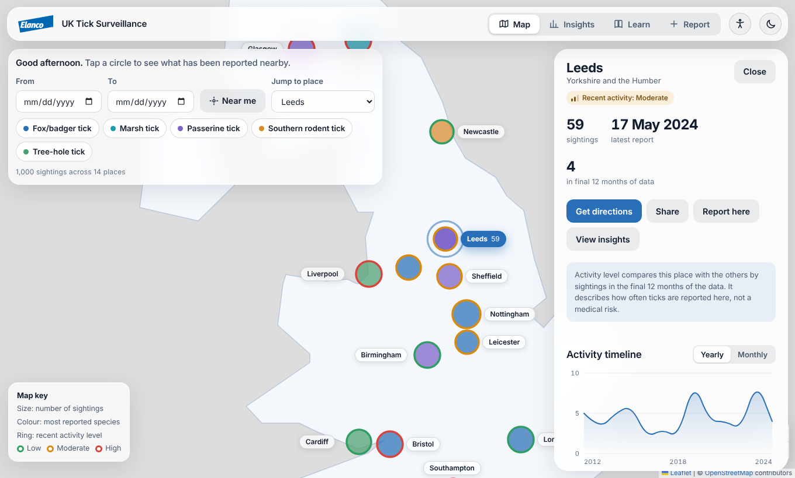
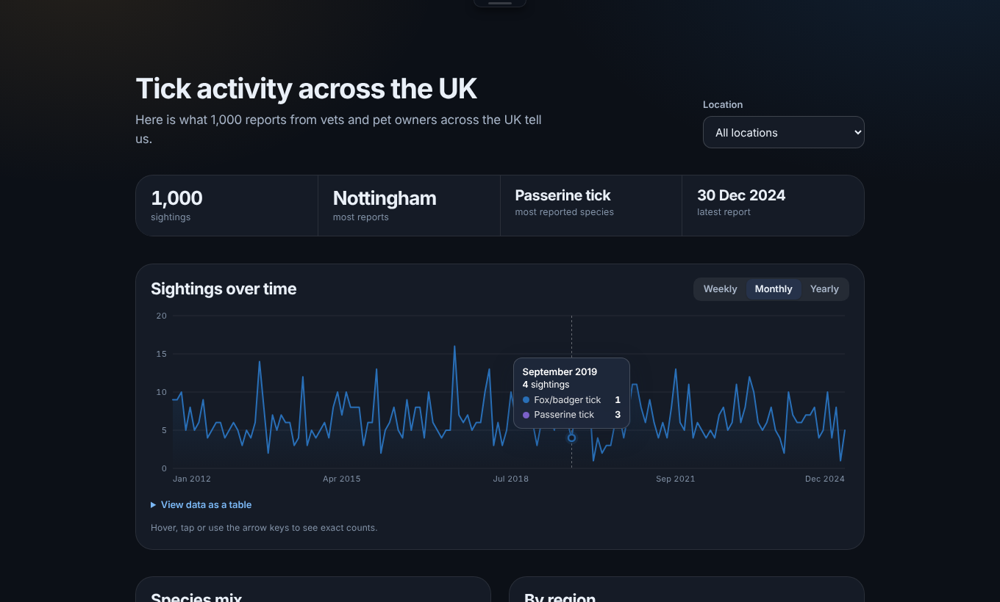
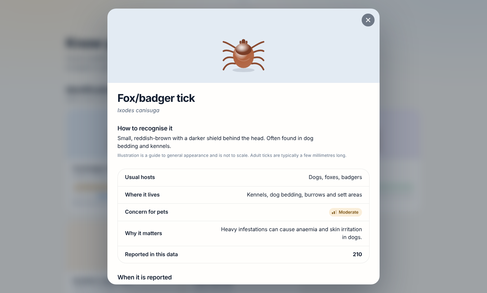
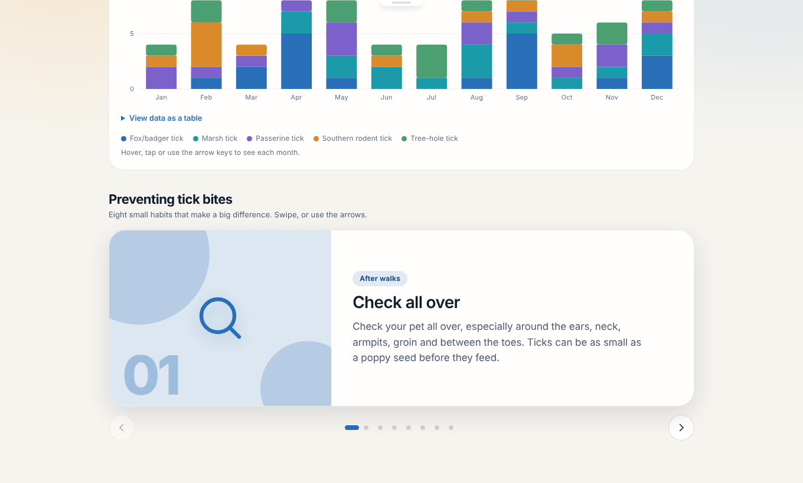
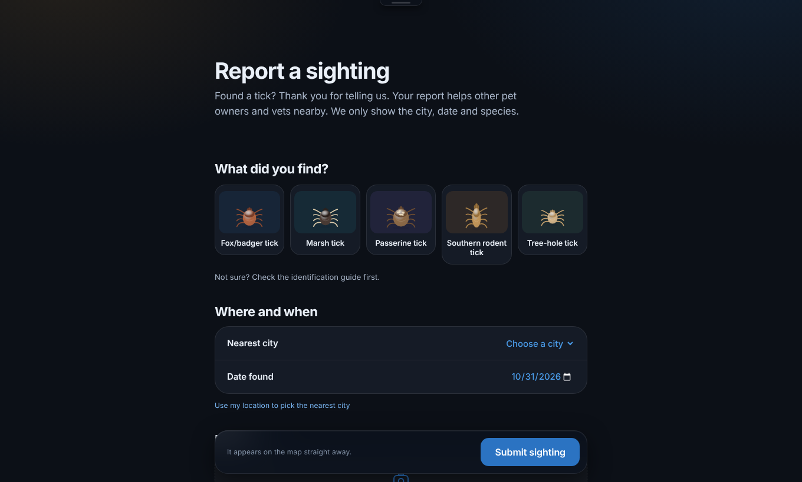
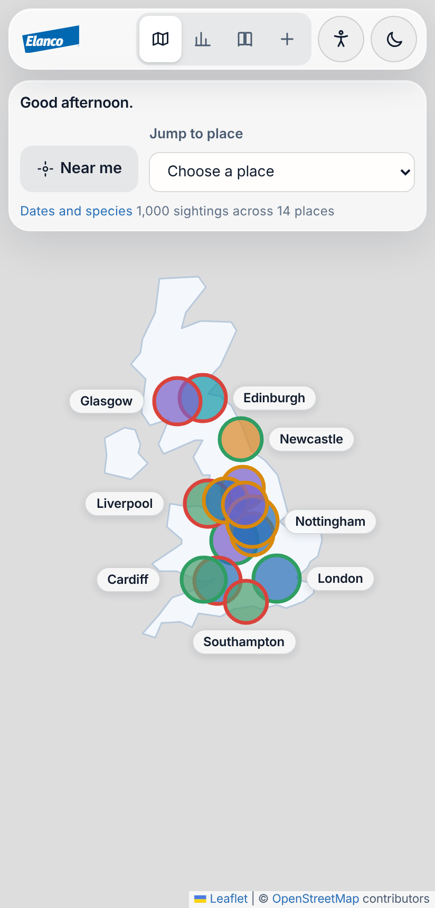
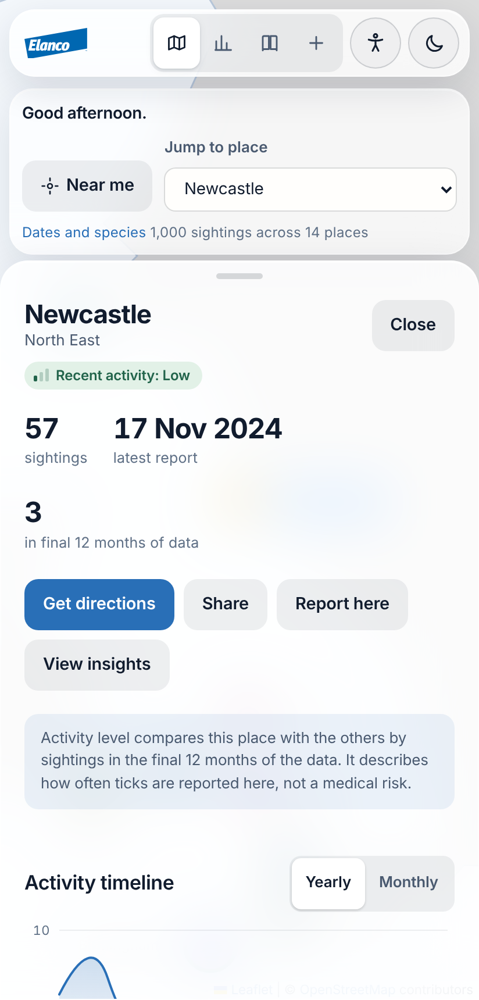

# UK Tick Surveillance — Elanco Full Stack Task

**Submitted by: Sarhan Alam Khan** — Elanco Placement Programme, Full Stack technical task.

A full-stack MVP that turns crowdsourced tick sighting data into a map, trend insights, an educational guide and a community reporting form. It opens with a short, skippable "system initialisation" intro built from the supplied intro feature spec.

> **Video walkthrough:** `VIDEO_LINK_HERE` (≤10 min, see [docs/VIDEO_SCRIPT.md](docs/VIDEO_SCRIPT.md))

## Run it

Requires **Node.js 22.13 or newer** (the backend uses the built-in `node:sqlite`, so there is no native database dependency to compile).

```bash
npm run install:all     # installs root, backend and frontend dependencies
npm run dev             # API on :4000, web app on http://localhost:5173
npm test                # backend test suite (12 tests)
```

Or run each half separately: `cd backend && npm start` and `cd frontend && npm run dev`.

Optional environment variables for the API: `PORT` (4000), `DB_PATH`, `ELANCO_API_URL` (default `https://dev-task.elancoapps.com/`), `ELANCO_API_PATH` (default `/`).


- **Built for everyone:** easy-to-read style, colour-blind-safe palette, read-aloud, CSV download, print layout, offline notice, skip-intro setting (see `docs/ACCESSIBILITY.md`).

## Screenshots
Captured from the running app (map tiles are blocked in these captures, so the basemap shows the built-in UK outline instead).

| Map, light | Insights, dark |
|---|---|
|  |  |
| **Learn: species detail** | **Learn: tips slideshow** |
|  |  |
| **Report form, dark** | **Phone: map and details sheet** |
|  |   |

## What is built

**Backend (Node, Express 5, TypeScript, SQLite, Zod)**

| Requirement | Where |
|---|---|
| Consume and process the provided API | `backend/src/ingest.ts`: fetch with timeout, validate, normalise, de-duplicate, then bulk insert in one transaction |
| Large datasets, duplicates, incomplete data | Rows are validated individually. Bad rows are counted by reason and skipped, never fatal. Duplicate ids are dropped in memory and by `INSERT OR IGNORE`. A missing Latin name is filled from reference data. Indexed columns and server-side pagination (max 500 per page) |
| Accept new sightings | `POST /api/sightings` (multipart, optional image) |
| Search and filter by time range and location | `GET /api/sightings?from&to&location&species&page&limit&sort` |
| Aggregate insights | `GET /api/insights/by-region`, `/trends?interval=week\|month\|year`, `/seasonality` |
| Map data | `GET /api/map/markers` (one marker per city, same filters) |
| Error handling | Upstream failure falls back to the bundled snapshot and reports it in `/api/health`. Invalid input returns `400`/`422` with field-level `{field, message}` details. Images are checked by MIME type and file signature, 5 MB cap. All errors share one JSON shape |

**Frontend (React 19, TypeScript, Vite, Leaflet, Framer Motion)** — at least two requirements from each area:

- **Interactive map:** Leaflet map of UK cities. Marker size is the number of sightings, colour the most reported species, and a dark ring marks above-average recent activity. Filters for date range and species, plus a place jump menu.
- **Sighting information:** a side panel (bottom sheet on mobile) opens from a marker. It has yearly/monthly timeline, species breakdown, latest sightings (expandable, with photos) and **Get directions** / **Share** / **Report here** actions.
- **Educational content:** illustrated species cards; click one and it expands into a detail sheet (how to recognise it, hosts, habitat, its own seasonality chart, top places, and a "Report this tick" shortcut). Also a seasonal chart for any city and prevention tips. The pictures are original SVG drawings (not photographs); swap in licensed photos in `TickArt.tsx` if you prefer.
- **Report a sighting:** illustrated species tiles, grouped city/date rows, drag-and-drop photo, sticky submit bar, validation with an error summary, inline errors and a success message with non-blocking warnings (for example a likely duplicate). Image upload with preview and size/type checks.
- **Severity:** each species has a *pet concern* rating (Low/Moderate), and each place has a *recent activity* level (High/Moderate/Low, ranked on sightings in the final 12 months of data). Shown as map marker rings, badges, and in the report form. Text + icon, not colour alone. Indicative only, not veterinary advice.
- **Linked screens:** map panel ↔ insights (View insights / Open on map), insights species/places → map, species → Learn guide, Learn → map filtered by species or place, report form → guide and map.
- **Dark mode:** light/dark theme (follows the system setting, remembered after you choose). Switching uses a circular reveal from the toggle; falls back to an instant switch where View Transitions are unsupported or motion is reduced.
- **Header:** a floating glass nav bar that slides away when the mouse leaves the top of the window and slides back when it comes close (or when it receives keyboard focus). Touch devices keep it visible.
- **Tips slideshow:** the prevention tips are an 8-slide carousel (arrows, dots, swipe/drag, left/right keys, no autoplay).
- **Tone:** friendly copy (time-of-day greeting on the map, thank-you messages), warm light palette.
- **Branding:** the supplied Elanco SVG logo is used throughout (`frontend/public/elanco-logo.svg`, inline component `ElancoLogo`).
- **Map labels:** every place is labelled with its name, the selected place is highlighted with a filled label and halo, and labels are real buttons (keyboard and screen-reader friendly). "Near me" picks your closest place using the browser location (nothing is stored or sent).
- **Accessibility and ease of use:** display settings (text size, high contrast, reduced motion, always-visible nav), keyboard shortcuts, a first-visit guide (press ?), skip link, page announcements, chart data tables. See `docs/ACCESSIBILITY.md`.
- **Charts:** every chart has hover/touch tooltips with exact values (per species where relevant) and arrow-key navigation.
- **Design:** Apple-style design system (SF type, translucent materials, spring motion, press feedback).
- **Map tiles:** OpenStreetMap tiles (see OSM tile usage policy; use a hosted provider for heavy traffic) with a built-in UK outline underneath, so the map still reads if tiles cannot load.
- **Insights page:** counts per region and place, species mix and a weekly/monthly/yearly trend.
- **Accessibility:** semantic landmarks, labelled controls, visible focus, keyboard-reachable skip/sound controls, ARIA live regions, text alternatives on charts, and support for `prefers-reduced-motion`, `prefers-reduced-transparency` and `prefers-contrast`.

### Intro feature
Implemented from `docs/intro-feature-spec.json` as an isolated component (`frontend/src/intro/`). Highlights:
- Logo wipe-in with a light sweep, data lines converging while "connecting", a drawing map outline, a radar sweep and pin ripples, and status text that decodes into place (decorative; READY is still gated on real data).
- Five stages with the specified text, styled as a professional loading screen: step counter, segmented progress bar, a "data link" readout that reports the real API state (waiting / received / unavailable), species cards, and rotating "did you know" tips. It runs about 9 s on desktop and about 6 s on mobile.
- **Length:** the supplied spec asks for 5-7 s. The longer version is a deliberate choice; set `INTRO_LENGTH = 'spec'` at the top of `frontend/src/intro/Intro.tsx` to return to the ~6.4 s timing. Skip is available from the first frame, and returning visitors get a short version.
- **Skip** is available immediately (button, `Esc`). Sound is **off by default**, only created after a click, and lazy-loaded (Web Audio, no assets).
- The final "READY" message is shown **only if the API really answered**. If data is slow or fails the intro exits without claiming success, and the dashboard shows an error with a retry button.
- Shown in full on a first visit, shortened for returning visitors, a simple static version for reduced motion, and skipped for the rest of the browser session. An error boundary hands over to the dashboard if anything in the intro fails.

## Data notes and assumptions
- The sandbox I built this in could not reach `dev-task.elancoapps.com`, so the snapshot in `backend/data/sightings.snapshot.json` (the 1,000-record response supplied with the task) is bundled and used as the fallback. On startup the API tries the live endpoint first; the exact response shape of the live service is handled for a bare array or `{sightings|data: []}`. **If your live path differs, set `ELANCO_API_PATH`.**
- Records carry only a city name, so coordinates and region come from a 14-city reference table (`backend/src/geo.ts`). Records for any other city are rejected and counted. The supplied data contains no such records.
- All 1,000 supplied records are valid and unique; the pipeline is still written to cope with bad and duplicate data (covered by tests).
- "Recent activity" on the map is measured against the latest **imported** record (the data ends in Dec 2024), so new community reports do not distort it.
- Species colours are unique per species. There is no medical severity in the data, so none is invented.

## Technical choices
See [docs/ARCHITECTURE.md](docs/ARCHITECTURE.md) for the reasoning, the trade-offs and what I would improve with more time.

## Project layout
```
backend/   Express API, SQLite storage, ingest pipeline, tests (src/api.test.ts)
frontend/  React app: views/, components/, intro/ (isolated intro feature)
docs/      Architecture notes, video script, intro feature spec
docs/ACCESSIBILITY.md          Accessibility statement and checks
docs/WIREFRAMES.md             Low-fidelity wireframes for the four screens
.claude/skills/apple-design/   Skill used to guide motion and interaction details
```

## Tests
`npm test` covers ingest normalisation, filtering, pagination, aggregation, validation errors, file-upload checks and duplicate warnings.

## Tests
- `npm test` runs the 13 backend tests (ingest, validation, filters, insights, uploads).
- `npm run test:e2e` runs 10 browser tests (Playwright): map labels and selection, chart tooltips and table alternatives, Learn cards and slideshow, report validation and submit, page links, settings and shortcuts, the mobile swipe-to-close sheet, and an automated axe accessibility scan of every page in light and dark. It starts its own API (with a throwaway database) and dev server. First time only: `npx playwright install chromium`.
